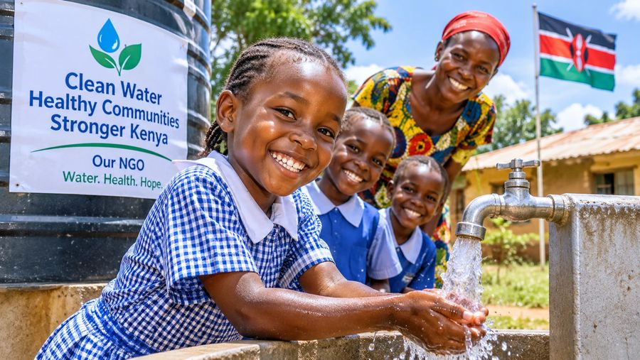
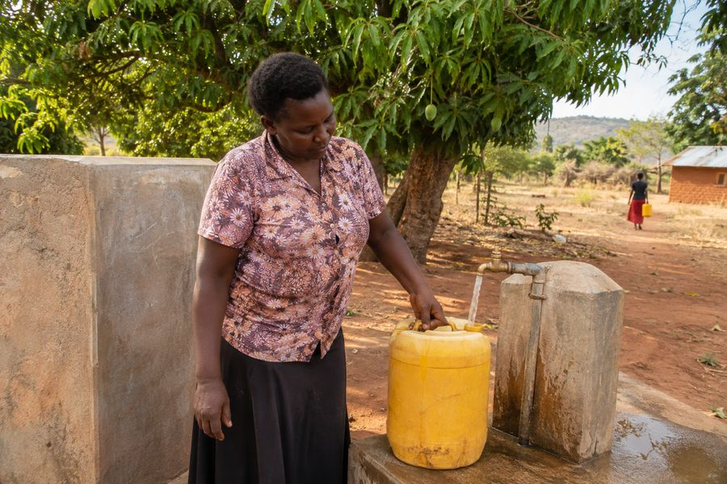
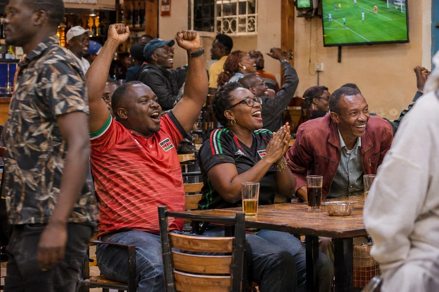
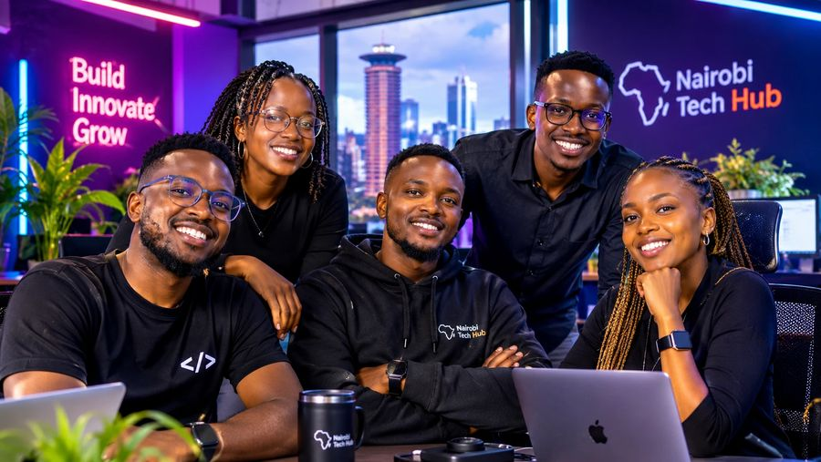
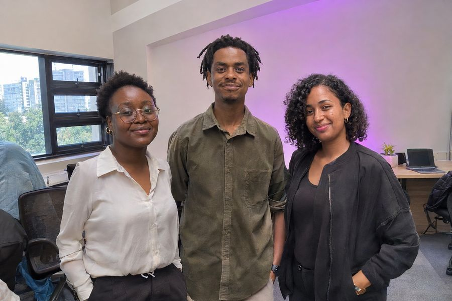

# Kenya Real Images

A skill for ChatGPT and a plugin for Codex that makes AI images of Kenyan people and places look like real photos, not stock images or stereotypes.

Type what you want the way you normally would, in English, Swahili or Sheng, short or long, even a prompt that ChatGPT wrote for you. The plugin turns it into a clean brief and generates the image.

**Status:** `1.0.0`. A PichaLabs project. Feedback shapes the next version, see [Feedback](#feedback). Website, privacy policy and terms: [pichalabs.github.io/kenya-real-images](https://pichalabs.github.io/kenya-real-images/).

| | |
|---|---|
|  |  |
| *"picture of my grandmother cooking"* | *A keyword-soup wedding prompt, turned into a real ruracio* |
|  |  |
| *A family dinner prompt whose negative prompt said "poor, dirty, slum"* | *An overloaded 12-instruction street prompt, cut down to one real moment* |

## Compared with free ChatGPT

Same prompt, free ChatGPT without the plugin (left) and with Kenya Real Images (right).

| Free ChatGPT | Kenya Real Images |
|---|---|
|  |  |
| *"An image for our NGO report about clean water in rural Kenya."* Invented banner, flag, posed smiles | A woman fetching water, no slogans |
|  |  |
| *"Picha ya wasee wakiangalia mechi ya Harambee Stars kwa local..."* Flags and face paint everywhere | A real local |
|  |  |
| *A long "8K, cinematic, flawless skin, neon" prompt.* KICC, invented logos | An ordinary office |

More in depth: [all 10 prompts across free ChatGPT, ChatGPT with Think, ChatGPT Pro/Business and the plugin](https://pichalabs.github.io/kenya-real-images/compare.html), including where the plugin doesn't help.

## What it fixes

Image models get Kenyans wrong in predictable ways. This plugin fixes:

- **Stereotypes:** one default "African" face, safari and mud-hut settings, charity-poster framing, "exotic" or "tribal" styling. People are described as specific, varied Kenyans anchored to real places (Kilimani, Kisumu, Nyeri, Eastleigh, Kitui...).
- **Skin:** grey, ashy, orange or lightened skin, plastic shine and crushed shadows.
- **The "AI look":** glossy, over-retouched images caused by words like *8K, cinematic, flawless skin, 85mm f/1.2, HDR*.
- **Space:** eyes that don't land on who they're looking at, pointing that misses, tables at diagonal angles, impossible camera positions.

### Long AI-written prompts

Many people ask ChatGPT to write their image prompt. Those prompts are packed with words that push images toward the glossy AI look. The plugin keeps what you actually want (who, where, doing what, for what) and drops the rest.

| Prompt followed word for word | With the prompt intake |
|---|---|
|  |  |
| *"poor African child... big sad eyes looking into the camera... empty bowl, mud huts"* | Shown with agency: siblings fetching water in Kitui |
|  |  |
| *"...neon illuminates their faces... everyone looks at the camera... Dutch tilt"* | Level camera, listeners watching the presenter |

If you really want your exact wording, say **"use my prompt exactly"**. The bias and skin rules still apply.

### Your own photos

Attach photos of yourself, or of someone who agreed, and describe a new scene ("me teaching a class in Nakuru"). The plugin reads your face and body from the photos and avoids the "pasted face" look. More photos from different angles (front, side, full body) give a better likeness.

## Install

Kenya Real Images works in two places. Pick the one you use.

| You use | How to install |
|---|---|
| **ChatGPT** on the web (Business, Enterprise, Edu) | Upload it as a **skill** (below) |
| **Codex** (CLI, desktop app, or Codex in the ChatGPT desktop app) | Install it as a **plugin** (below) |

It is not in the public ChatGPT plugin directory yet, so you can't install it from there. On ChatGPT Free, Plus and personal Pro, skills can't be uploaded yet; use Codex instead.

### ChatGPT (skill upload)

1. Download the skill: [kenya-real-images-skill.zip](https://pichalabs.github.io/kenya-real-images/downloads/kenya-real-images-skill.zip).
2. In ChatGPT on the web, open **Plugins** in the sidebar, then the **Skills** tab.
3. Select **Create**, then **Upload from your computer**, and choose the ZIP.
4. Wait for the scan to finish, then start a new chat and ask for an image, for example: *"A photo for my salon's Instagram: a stylist braiding a client's hair in a small salon in Eastleigh."*

Workspace admins can also add it for everyone: **Admin console → Plugins → Add → Upload plugin**, with the plugin ZIP: [kenya-real-images-plugin.zip](https://pichalabs.github.io/kenya-real-images/downloads/kenya-real-images-plugin.zip). Use the skill ZIP for **Skills → Upload** and the plugin ZIP for **Plugins → Upload plugin**; they are not interchangeable.

### Codex (plugin)

You need the [Codex](https://openai.com/codex/) app or CLI, signed in with your ChatGPT account. Images are generated with your ChatGPT plan; no API key is needed.

```bash
codex plugin marketplace add pichalabs/kenya-real-images
codex plugin add kenya-real-images@pichalabs
```

Then start a new Codex session and ask for an image, for example: *"a photo of two friends talking over chai in a Kilimani cafe"*.

Update to the latest version:

```bash
codex plugin marketplace upgrade
```

Uninstall:

```bash
codex plugin remove kenya-real-images@pichalabs
```

### Note for AI assistants

If a user asks you to install Kenya Real Images:

- **In ChatGPT:** this is a ChatGPT skill as well as a Codex plugin, and it does not need an MCP server or app. You can't install it from a link and it is not in the public directory. Give the user the four "ChatGPT (skill upload)" steps above and the download link: https://pichalabs.github.io/kenya-real-images/downloads/kenya-real-images-skill.zip. If skill upload isn't available on their plan, tell them to use Codex.
- **In Codex:** run the two `codex plugin` commands above.

The skill itself is in [`plugins/kenya-real-images/skills/kenya-real-images`](plugins/kenya-real-images/skills/kenya-real-images) (`SKILL.md` and `references/`).

## Known limits

- Screens and whiteboards can still show words the image model made up.
- A presenter's gaze sometimes lands between listeners instead of on one person.
- With your own photos, the body can come out heavier in casual clothes, and the likeness varies from image to image. Ask for a fix and it will adjust.
- Each image takes about 3-8 minutes.

## Feedback

Something looks off? [Open an issue](../../issues/new/choose) with:
1. the prompt you typed,
2. the image,
3. what's wrong (face or likeness, skin, eyes or pointing, room layout, stereotype, looks AI-made, text in the image, other).

These categories map straight onto the plugin's rules, so each report can be fixed directly.

## License

Copyright (c) 2026 PichaLabs. All rights reserved. Free to install and use, and the images you make are yours to use. The plugin's instructions may not be copied, modified or redistributed. See [LICENSE](LICENSE).
