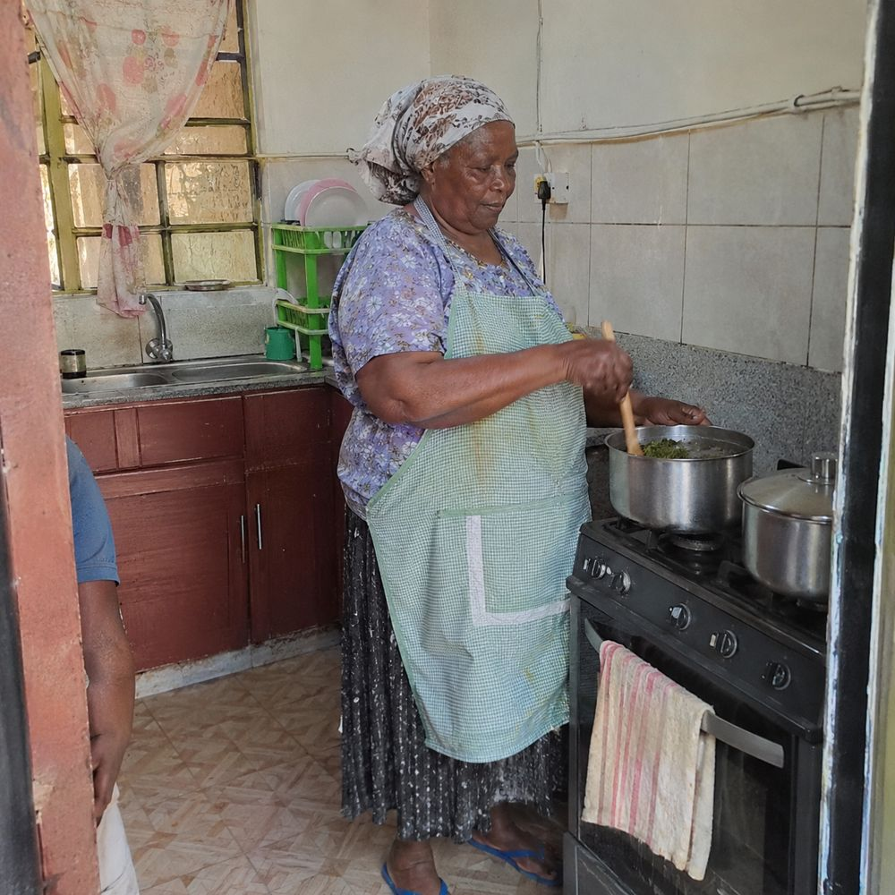
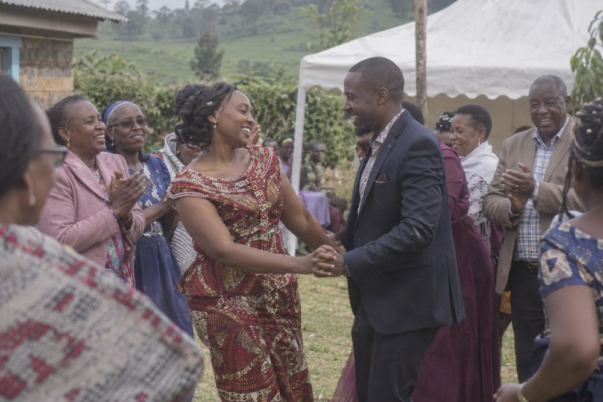
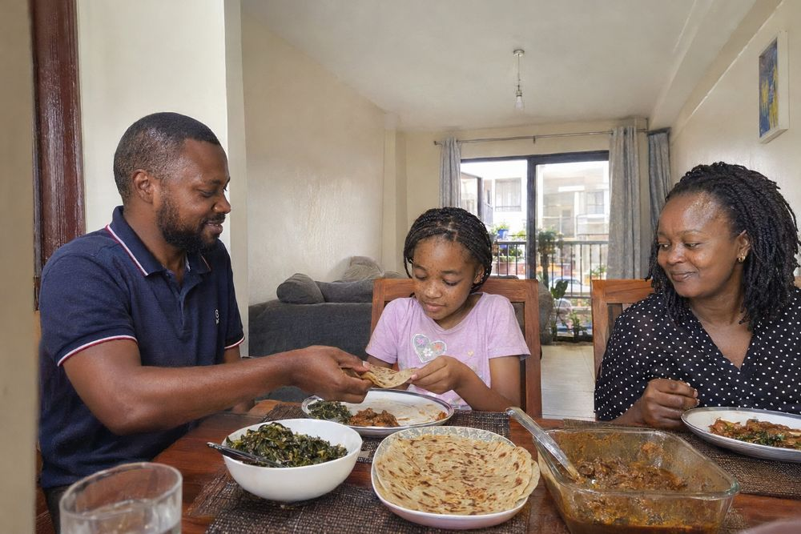
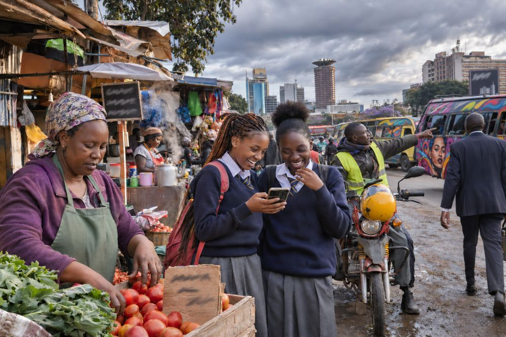
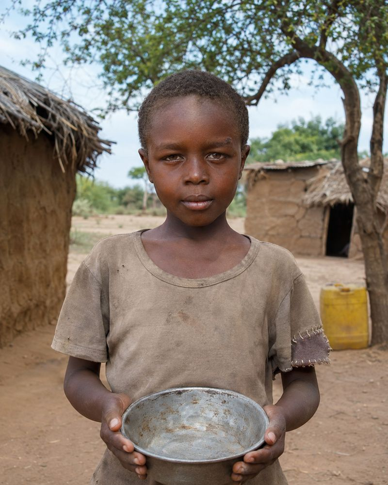
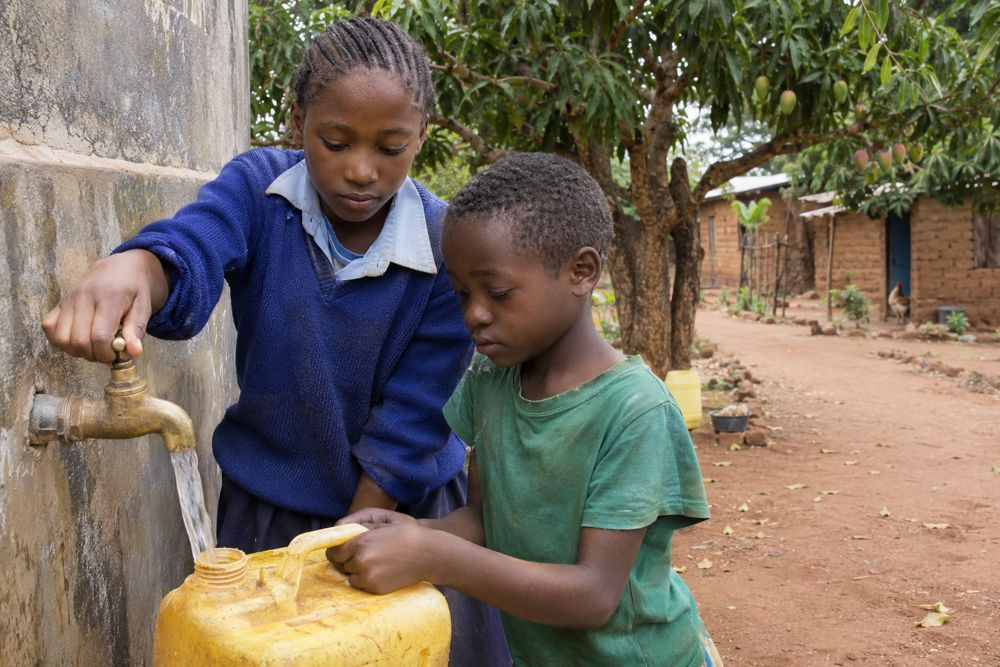
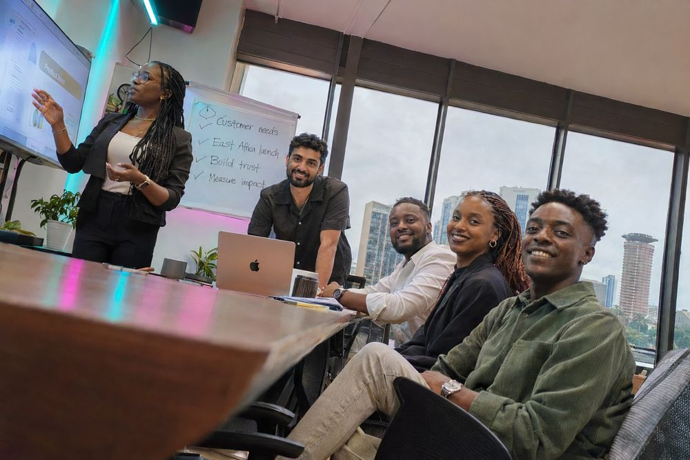
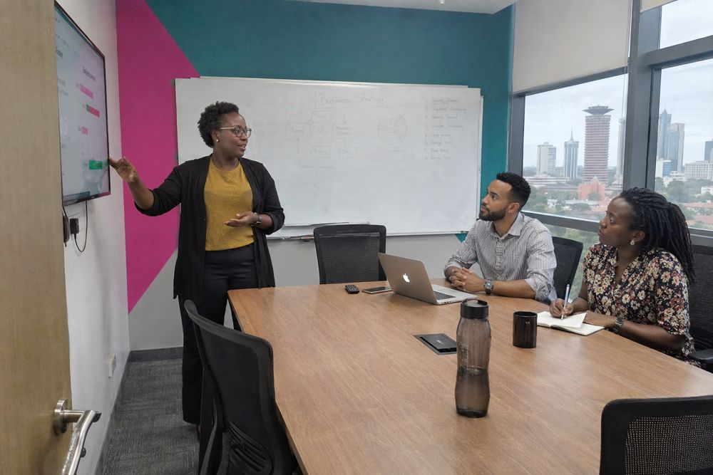

# Kenya Real Images

A plugin for Codex that makes AI images of Kenyan people and places look like real photos, not stock images or stereotypes.

Type what you want the way you normally would, in English, Swahili or Sheng, short or long, even a prompt that ChatGPT wrote for you. The plugin turns it into a clean brief and generates the image.

**Status:** public beta (`1.0.0-beta.3`). Feedback shapes the next version, see [Feedback](#feedback).

| | |
|---|---|
|  |  |
| *"picture of my grandmother cooking"* | *A keyword-soup wedding prompt, turned into a real ruracio* |
|  |  |
| *A family dinner prompt whose negative prompt said "poor, dirty, slum"* | *An overloaded 12-instruction street prompt, cut down to one real moment* |

## What it fixes

Image models get Kenyans wrong in predictable ways. This plugin fixes:

- **Stereotypes:** one default "African" face, safari and mud-hut settings, charity-poster framing, "exotic" or "tribal" styling. People are described as specific, varied Kenyans anchored to real places (Kilimani, Kisumu, Nyeri, Eastleigh, Kitui...).
- **Skin:** grey, ashy, orange or lightened skin, plastic shine and crushed shadows.
- **The "AI look":** glossy, over-retouched images caused by words like *8K, cinematic, flawless skin, 85mm f/1.2, HDR*.
- **Space:** eyes that don't land on who they're looking at, pointing that misses, tables at diagonal angles, impossible camera positions.

### Long AI-written prompts

Many people ask ChatGPT to write their image prompt. Those prompts are packed with words that push images toward the glossy AI look. The plugin keeps what you actually want (who, where, doing what, for what) and drops the rest.

| Prompt followed word for word | With the prompt intake |
|---|---|
|  |  |
| *"poor African child... big sad eyes looking into the camera... empty bowl, mud huts"* | Shown with agency: siblings fetching water in Kitui |
|  |  |
| *"...neon illuminates their faces... everyone looks at the camera... Dutch tilt"* | Level camera, listeners watching the presenter |

If you really want your exact wording, say **"use my prompt exactly"**. The bias and skin rules still apply.

### Your own photos (beta)

Attach photos of yourself, or of someone who agreed, and describe a new scene ("me teaching a class in Nakuru"). The plugin reads your face and body from the photos and avoids the "pasted face" look. More photos from different angles (front, side, full body) give a better likeness.

## Install

You need the [Codex](https://openai.com/codex/) app or CLI, signed in with your ChatGPT account. Images are generated with your ChatGPT plan; no API key is needed.

```bash
codex plugin marketplace add OWNER/kenya-real-images
codex plugin add kenya-real-images@pichalabs
```

Then start a new Codex session and ask for an image, for example: *"a photo of two friends talking over chai in a Kilimani cafe"*.

Update to the latest version:

```bash
codex plugin marketplace upgrade
```

Uninstall:

```bash
codex plugin remove kenya-real-images@pichalabs
```

## Known limits

- Screens and whiteboards can still show words the image model made up.
- A presenter's gaze sometimes lands between listeners instead of on one person.
- With your own photos, the body can come out heavier in casual clothes, and the likeness varies from image to image. Ask for a fix and it will adjust.
- Each image takes about 3-8 minutes.

## Feedback

Something looks off? [Open an issue](../../issues/new/choose) with:
1. the prompt you typed,
2. the image,
3. what's wrong (face or likeness, skin, eyes or pointing, room layout, stereotype, looks AI-made, text in the image, other).

These categories map straight onto the plugin's rules, so each report can be fixed directly.

## License

Copyright (c) 2026 PichaLabs. All rights reserved. Free to install and use, and the images you make are yours to use. The plugin's instructions may not be copied, modified or redistributed. See [LICENSE](LICENSE).
